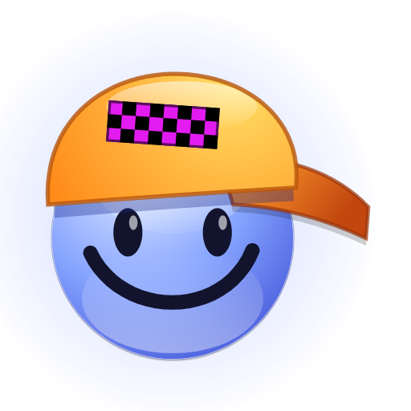
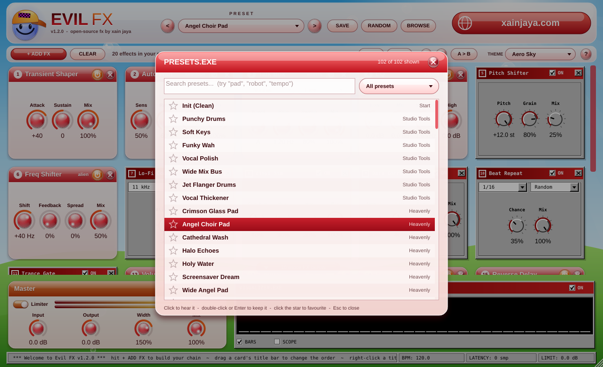

# Evil FX

A free multi-effect plugin by [Xain Jaya](https://xainjaya.com). It's what you'd get if a 2009 Windows Vista install and an old Geocities page made an audio plugin together.

Runs as VST3, CLAP, AU, LV2 or a standalone app on Windows, macOS and Linux.




## How it works

There are 39 effects in here, but you only see the ones you're using. Click **+ ADD FX**, pick something, and it drops into your rack as a card. Close it with the X, or hit the power button if you just want to bypass it for a sec (double-clicking the title bar does the same thing).

Want the reverb before the distortion? Drag the card by its title bar and drop it where you want it. Right-clicking the title bar gives you a few shortcuts too, including putting everything back in the default order.

A few other things worth knowing:

- **UNDO / REDO** works on pretty much everything: knob moves, loading presets, hitting RANDOM, adding or moving effects. Ctrl+Z / Cmd+Z works too.
- **A / B** holds two different sounds so you can flip between them and compare. "A > B" copies whatever you're hearing into the other slot.
- **BROWSE** (or Ctrl/Cmd+F) lets you search the presets and star the ones you like. Starred presets show up at the top of the preset menu.
- The left and right arrow keys step through presets.
- Anything that's switched off doesn't use any CPU, and there's a limiter at the very end so nothing can blow your speakers out.

## The effects

This is the default order. You can rearrange them however you want, and the order gets saved with your project and your presets.

| # | Effect | What it does |
|---|--------|--------------|
| 1 | Noise Gate | Cuts the signal when it drops below the threshold. Can listen to the sidechain instead. |
| 2 | Transient Shaper | More or less punch on the attack, more or less tail. |
| 3 | Auto-Tune | Snaps pitch to a key and scale. Set Speed all the way down for the hard T-Pain sound. |
| 4 | Filter | Low pass, band pass or high pass with an LFO that can sync to tempo. |
| 5 | Auto-Wah | The harder you play, the more it opens up. |
| 6 | Talk Box | Sweeps through vowel sounds (A E I O U) so it sounds like it's talking. |
| 7 | EQ | Low, mid and high. |
| 8 | Saturation | Gentle warm drive. |
| 9 | Fuzz | Actual distortion. Fuzz, Hard Clip, Octave Up or Wavefolder. |
| 10 | Pitch Shifter | Up or down a full octave. |
| 11 | Ring Modulator | Metallic, bell-ish tones. The Arp knob turns it into an old ringtone. |
| 12 | Freq Shifter | Shifts everything by the same number of Hz. A little thickens things up, a lot sounds alien. |
| 13 | Vocoder | Makes your sound "sing" through a synth, a chord, noise, or whatever's on the sidechain. |
| 14 | Robot Voice | Old text-to-speech robot. |
| 15 | Lo-Fi Codec | 90s computer audio: low sample rates and old codecs like u-Law and ADPCM. |
| 16 | Bitcrusher | Fewer bits, lower sample rate. |
| 17 | Telephone | Phone line, hiss, crackle, and an optional dial-up modem squeal. |
| 18 | Vinyl Sim | Crackle, dust and a worn-out record. |
| 19 | MP3 Compression | That swirly, underwater sound of a really low bitrate MP3. |
| 20 | Packet Loss | Voice chat breaking up. |
| 21 | Stutter | Like a stream that keeps buffering. |
| 22 | Data Corruption | Bit flips and little reversed chunks, like a broken download. |
| 23 | Varispeed | Slows down then catches up, like a lag spike. |
| 24 | Wow & Flutter | Wobbly tape. |
| 25 | Beat Repeat | Repeats, stutters, reverses and tape stops, locked to your tempo. |
| 26 | Trance Gate | Chops the sound in rhythm. 8 patterns. |
| 27 | Sidechain Pump | Ducks on the beat, or follows a kick you send to the sidechain. |
| 28 | Volume Swell | Fades every new note in, like a violin. |
| 29 | Chorus | Thickens things up. |
| 30 | Flanger | Jet plane whoosh. |
| 31 | Phaser | Swirly. |
| 32 | Tremolo / Pan | Volume wobble that can turn into auto-pan. |
| 33 | Stereo Widener | Makes it wider without wrecking it in mono. |
| 34 | Reverse Delay | Plays chunks of your sound backwards. |
| 35 | Delay | Echo, with ping-pong and tempo sync. |
| 36 | Blur | Smears everything into a big ambient wash. Freeze holds it forever. |
| 37 | Reverb | Big room. |
| 38 | Compressor | Simple compressor, makes up the volume for you. |
| 39 | Speaker Sim | PC speaker, laptop, flip phone, earbuds, CRT TV or boombox. |

Beat Repeat, Trance Gate, Sidechain Pump and both delays follow your project tempo. Filter, Talk Box, Chorus, Flanger, Phaser and Tremolo have a Sync dropdown if you want their wobble on the beat too. If your DAW's transport is stopped they just keep going at the project BPM.

### Using the sidechain

Route something (usually a kick) into Evil FX's sidechain input in your DAW. Then set Sidechain Pump's Source, the Noise Gate's Key, or the Vocoder's Carrier to "Sidechain In". You'll see "SC" in the status bar at the bottom when it's getting a signal. If nothing's connected those effects just behave normally.

## Presets

There are 102 presets, sorted into Studio Tools, Heavenly, Ambient Pads, Internet Era, Rhythm & Glitch, Lo-Fi & Speakers, Chaos, Vocals & Robots, Fuzz & Drive and Tempo Motion. RANDOM throws a few effects together with random settings, which is honestly where some of the best sounds come from.

Hit SAVE to keep your own. They go in `Documents/Evil FX/Presets` as `.evilfx` files, so you can send them to people.



## Themes

Three backgrounds, picked from the THEME menu: Aero Sky (the default), Frutiger Metro (flat Windows 8 tiles) and Crimson Grid (synthwave sunset).


There's also VISUALIZER.EXE at the bottom, a WinAmp-style spectrum/scope. It's off by default and doesn't cost anything while it's off.

## Installing

Grab the installer for your system from the Releases page:

- **Windows:** `EvilFX-<version>-Windows-Setup.exe`
- **Mac:** `EvilFX-<version>-macOS.pkg`
- **Linux:** `EvilFX-<version>-Linux.tar.gz`. Unzip it and run `./install.sh`

Both installers let you pick which formats you want. If you'd rather copy things in yourself:

| Format | Windows | macOS | Linux |
|--------|---------|-------|-------|
| VST3 | `C:\Program Files\Common Files\VST3\` | `~/Library/Audio/Plug-Ins/VST3/` | `~/.vst3/` |
| CLAP | `C:\Program Files\Common Files\CLAP\` | `~/Library/Audio/Plug-Ins/CLAP/` | `~/.clap/` |
| AU | | `~/Library/Audio/Plug-Ins/Components/` | |
| LV2 | | | `~/.lv2/` |

For VST3, copy the whole `Evil FX.vst3` folder, not just the file inside it.

If a Mac build won't open because it's unsigned, run `xattr -cr "Evil FX.vst3"` on it.

**FL Studio:** go to Options > Manage plugins, make sure your VST3 folder is in the list, tick "Verify plugins", hit "Find installed plugins", then star Evil FX so it shows up in your browser.

## Building it yourself

You'll need CMake 3.22 or newer and a C++17 compiler (Visual Studio 2022, Xcode 14+, or GCC 11+/Clang 14+). JUCE and the CLAP wrapper get downloaded for you.

```bash
cmake -B build -DCMAKE_BUILD_TYPE=Release
cmake --build build --config Release --parallel
```

Everything ends up in `build/EvilFX_artefacts/Release/`.

- On Mac, add `-DCMAKE_OSX_ARCHITECTURES="arm64;x86_64"` to build for both Intel and Apple Silicon.
- To skip CLAP, add `-DEVIL_BUILD_CLAP=OFF`.
- On Linux you'll need these packages first: `build-essential cmake ninja-build libasound2-dev libjack-jackd2-dev libfreetype6-dev libfontconfig1-dev libx11-dev libxcomposite-dev libxcursor-dev libxext-dev libxinerama-dev libxrandr-dev libxrender-dev libglu1-mesa-dev`

### Tests

The build also makes `EvilFXTests`. Run it with no arguments and it puts every effect and preset through a stress test, fuzzes the parameters, and checks that things like reordering, undo and A/B actually work. `--bench` shows how much CPU each effect uses. With everything switched on it's about 9% of one core; most effects on their own are well under 1%.

### Releases and code signing

GitHub Actions builds Windows, Mac and Linux on every push and runs the tests. Push a version tag (like `v1.2.0`) and it builds the installers and posts them as a GitHub Release.

Unsigned builds work fine, but Windows and macOS will show scary warnings when people install them. To get rid of those you need code signing certificates. Once you add these as repository secrets (Settings > Secrets and variables > Actions), signing turns on by itself:

| Secret | What goes in it |
|--------|-----------------|
| `WINDOWS_CERT_PFX_BASE64`, `WINDOWS_CERT_PASSWORD` | Your Windows signing certificate (.pfx, base64'd) and its password |
| `MACOS_CERT_P12_BASE64`, `MACOS_CERT_PASSWORD` | A .p12 with both your "Developer ID Application" and "Developer ID Installer" certificates |
| `MACOS_DEV_ID_APP`, `MACOS_DEV_ID_INSTALLER` | The names of those two, e.g. `Developer ID Application: Xain Jaya (ABCDE12345)` |
| `APPLE_ID`, `APPLE_TEAM_ID`, `APPLE_APP_PASSWORD` | For Apple notarization. The password is an [app-specific password](https://support.apple.com/102654), not your real one |

To base64 a certificate: `base64 -i cert.p12 | pbcopy` on a Mac, or `[Convert]::ToBase64String([IO.File]::ReadAllBytes("cert.pfx"))` in PowerShell. Mac certificates come from an Apple Developer account. For Windows you can buy one from somewhere like Certum, Sectigo or SSL.com, or use Azure Trusted Signing.

## Finding your way around the code

```
Source/
  Params.h              every parameter
  Rack.h                default effect order and what's in the rack
  Presets.h             factory presets, saving/loading, random
  PluginProcessor.*     runs the chain, tempo, master section, limiter
  PluginEditor.*        the window, rack, menus and themes
  dsp/                  the effects themselves
  ui/                   look and feel, effect cards, visualizer, preset browser
packaging/              installer scripts for Windows, Mac and Linux
Tests/HeadlessTests.cpp the test tool
```

To add a new effect:

1. Add its parameters in `Params.h`, including an on/off one called `yourfx_on`.
2. Write a class based on `xfx::Module` with `prepare`, `reset` and `process`. If it needs the tempo, take a `const Transport&`; if it needs the sidechain, a `const SideChain&`.
3. Add it to the `EvilFXProcessor` constructor, `ModuleIndex` and `Rack.h`, all at the same position, and bump `numModules`.
4. Give it a card in `moduleSpecs()` in `PluginEditor.cpp` and a menu category in `categoryOf()`.

Saved projects remember effects by name, so adding new ones won't break anyone's old sessions.

## What changed

**1.2**
- You can rearrange the effects now
- Undo/redo, A/B compare and the preset browser with favourites
- Tempo sync on the modulation effects
- New effects: Auto-Tune, Vocoder, Fuzz and Noise Gate, plus a sidechain input
- 19 new presets (102 total)
- CLAP version and real installers
- Cleaned up the colours so everything's readable on every theme, and redid the Frutiger Metro theme so it actually looks like Metro
- Fixed a bug, there since 1.0, where delay-type effects could occasionally read garbage and glitch out

**1.1**
- New logo: the blue smiley guy in the orange cap
- New effects: Talk Box, Freq Shifter, Flanger and Reverse Delay
- 18 new presets

## License

AGPL-3.0-or-later. See [LICENSE](LICENSE). Built with [JUCE](https://juce.com) under its AGPLv3 option.

VST is a trademark of Steinberg Media Technologies GmbH. Audio Unit is a trademark of Apple Inc.
