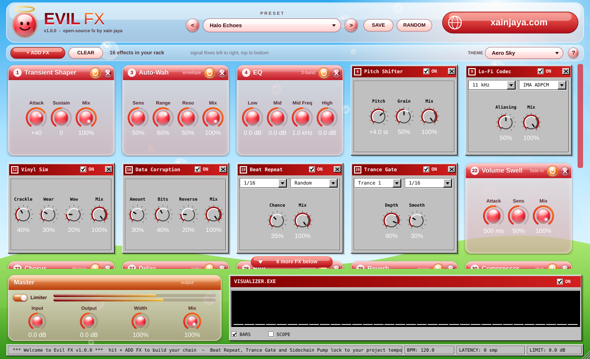
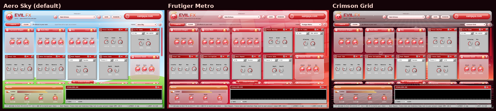

# Evil FX

**Free, open-source multi-FX for your DAW — crimson Frutiger Aero gloss meets the old-school internet.**
By [Xain Jaya](https://xainjaya.com). VST3 · AU · LV2 · Standalone. Windows, macOS, Linux.



31 effects, one tidy chain — but you only see the ones you add. Hit **+ ADD FX**, pick an effect from the categorized menu and its card drops into your **rack** (picking one that's already there jumps to it). Remove a card with its X, or bypass it with its power button. Effects that are off cost no CPU, and a safety limiter at the end keeps anything from blowing up your speakers.

---

## The chain

Signal always flows in this order, whichever effects you add.

| # | Effect | What it does | Controls |
|---|--------|--------------|----------|
| 1 | **Transient Shaper** | Boost or soften attacks and tails | Attack, Sustain, Mix |
| 2 | **Filter** | Resonant filter (LP / BP / HP) with an LFO sweep | Mode, Cutoff, Reso, LFO Rate, LFO Depth |
| 3 | **Auto-Wah** | Envelope filter: play harder, it opens further | Sens, Range, Reso, Mix |
| 4 | **EQ** | 3-band EQ: low shelf, sweepable mid, high shelf | Low, Mid, Mid Freq, High |
| 5 | **Saturation** | Warm drive with tilt EQ and auto-gain | Drive, Tone, Mix |
| 6 | **Pitch Shifter** | ±12 semitones | Pitch, Grain, Mix |
| 7 | **Ring Modulator** | Ring mod with an optional ringtone-style arpeggio | Freq, Shape, Arp, Mix |
| 8 | **Robot Voice** | Metallic text-to-speech robot | Pitch, Metal, Buzz, Mix |
| 9 | **Lo-Fi Codec** | 90s audio: 22–5.5 kHz through 8-bit PCM, u-Law, A-Law or IMA ADPCM | Rate, Codec, Aliasing, Mix |
| 10 | **Bitcrusher** | Bit-depth + sample-rate reduction | Bits, Rate, Mix |
| 11 | **Telephone** | Phone line with hiss, hum, crackle and optional modem squeal | Band, Noise, Crackle, Mix, Modem |
| 12 | **Vinyl Sim** | Crackle, dust pops, worn highs and 33⅓ rpm wow | Crackle, Wear, Wow, Mix |
| 13 | **MP3 Compression** | Real spectral low-bitrate codec artifacts | Bitrate, Artifacts, Mix |
| 14 | **Packet Loss** | VoIP dropouts — robot buzz, silence or comfort noise | Loss, Packet, Concealment, Mix |
| 15 | **Stutter** | Streaming-style stutters and dropouts | Chance, Slice, Dropout, Mix |
| 16 | **Data Corruption** | Bit flips and reversed fragments | Amount, Bits, Reverse, Mix |
| 17 | **Varispeed** | Slows down, then speeds up to catch up (lag spike) | Chance, Length, Depth, Mix |
| 18 | **Wow & Flutter** | Tape wow, flutter and clock drift | Wow, Flutter, Drift, Mix |
| 19 | **Beat Repeat 🎵** | Repeat / stutter / reverse / tape stop on the grid | Division, Style, Chance, Mix |
| 20 | **Trance Gate 🎵** | Rhythmic gate with 8 patterns | Pattern, Division, Depth, Smooth |
| 21 | **Sidechain Pump 🎵** | Ducking on 1/2 to 1/16 notes | Rate, Depth, Release |
| 22 | **Volume Swell** | Fades in every new note or chord | Attack, Sens, Mix |
| 23 | **Chorus** | Lush stereo chorus | Rate, Depth, Feedback, Mix |
| 24 | **Phaser** | Multi-stage phaser | Rate, Depth, Feedback, Mix |
| 25 | **Tremolo / Pan** | Tremolo that morphs into auto-pan | Rate, Depth, Shape, Pan |
| 26 | **Stereo Widener** | Mono-safe widener with slow motion | Width, Motion, Mix |
| 27 | **Delay 🎵** | Stereo / ping-pong delay with tone and tempo sync | Sync, Time, Feedback, Tone, Mix |
| 28 | **Blur** | Smears everything into a huge ambient wash. Shimmer adds octave-up sparkle, Freeze holds the sound forever | Size, Smear, Shimmer, Mix, Freeze |
| 29 | **Reverb** | Big hall reverb | Size, Damp, Width, Mix |
| 30 | **Compressor** | Easy compressor with auto makeup | Amount, Ratio, Speed, Mix |
| 31 | **Speaker Sim** | PC speaker, laptop, flip phone, earbuds, CRT TV, boombox | Model, Drive, Mix |
| — | **Master** | Input / output gain, stereo width, global mix, safety limiter + meter | |

🎵 = locks to your project tempo. With the transport stopped it keeps running on its own clock at the project BPM, so you can still hear it.

## Features

- **+ ADD FX menu** — effects grouped into Tone & Dynamics, Pitch & Voice, Lo-Fi & Internet Damage, Rhythm (BPM synced), Modulation & Stereo, and Ambient & Space. Ticks show what's already in your rack.
- **Full-width rack** — 5 cards across, scrolls when you add more, with a "more FX below" button and a glow on the card you just added or jumped to.
- **65 factory presets** in categories: Start, Studio Tools, Heavenly, Ambient Pads, Internet Era, Rhythm & Glitch, Lo-Fi & Speakers, Chaos.
- **Save your own presets** — hit **SAVE**. They're stored in `Documents/Evil FX/Presets` and appear under *Your Presets*. Share the `.evilfx` files with friends.
- **RANDOM** — switches on a few random effects with random settings.
- **Themes** — Aero Sky (default), Frutiger Metro and Crimson Grid, saved with your project.



- **VISUALIZER.EXE** — WinAmp-style spectrum bars or scope. Off by default; zero cost while off.
- **Lightweight** — the background is drawn once per theme, the UI only redraws what changes, and the audio thread never allocates.
- **Safe** — click-free switching, latency reported to your DAW, NaN guard, and a safety limiter.
- **? button** — quick help inside the plugin. The **xainjaya.com** button at the top right opens the website.
- **Huge ambient pads** — try the Ambient Pads presets, or Blur + Volume Swell + Reverb. Hit Freeze on Blur to hold a chord forever.

## CPU cost

Measured with `EvilFXTests --bench` (Release, 48 kHz stereo, one desktop core). Effects that are off are skipped entirely.

| Effect | CPU | Effect | CPU | Effect | CPU |
|---|---|---|---|---|---|
| Filter | 0.06 % | Telephone | 0.23 % | Sidechain Pump | 0.08 % |
| EQ | 0.07 % | Vinyl Sim | 0.14 % | Chorus | 0.12 % |
| Saturation | 0.21 % | MP3 Compression | 1.73 % | Phaser | 0.40 % |
| Pitch Shifter | 0.14 % | Packet Loss | 0.03 % | Tremolo / Pan | 0.14 % |
| Ring Modulator | 0.22 % | Stutter | 0.05 % | Stereo Widener | 0.08 % |
| Robot Voice | 0.27 % | Data Corruption | 0.06 % | Delay | 0.19 % |
| Lo-Fi Codec | 0.13 % | Varispeed | 0.03 % | Reverb | 0.25 % |
| Bitcrusher | 0.02 % | Wow & Flutter | 0.09 % | Compressor | 0.13 % |
| Beat Repeat | 0.03 % | Trance Gate | 0.03 % | Speaker Sim | 0.33 % |
| Blur | 0.60 % | Transient Shaper | 0.17 % | Volume Swell | 0.12 % |
| Auto-Wah | 0.07 % | | | **All 31 on** | **~6 %** |

## Building

You need **CMake 3.22+** and a C++17 compiler (Visual Studio 2022, Xcode 14+, or GCC 11+/Clang 14+). JUCE 8 is downloaded automatically.

```bash
cmake -B build -DCMAKE_BUILD_TYPE=Release
cmake --build build --config Release --parallel
```

Plugins land in `build/EvilFX_artefacts/Release/` (`VST3/`, `AU/`, `LV2/`, `Standalone/`).

GitHub Actions (`.github/workflows/build.yml`) builds Windows, macOS and Linux on every push, runs the tests and uploads the plugins as artifacts.

**Linux packages:** `build-essential cmake ninja-build libasound2-dev libjack-jackd2-dev libfreetype6-dev libfontconfig1-dev libx11-dev libxcomposite-dev libxcursor-dev libxext-dev libxinerama-dev libxrandr-dev libxrender-dev libglu1-mesa-dev` (or add `-DEVIL_MINIMAL_LINUX_DEPS=ON` in a stripped-down container).

**macOS:** add `-DCMAKE_OSX_ARCHITECTURES="arm64;x86_64"` for a universal build. Unsigned builds may need `xattr -cr "Evil FX.vst3"`.

### Installing

| Format | Windows | macOS | Linux |
|--------|---------|-------|-------|
| VST3 | `C:\Program Files\Common Files\VST3\` (copy the whole `Evil FX.vst3` folder) | `~/Library/Audio/Plug-Ins/VST3/` | `~/.vst3/` |
| AU | — | `~/Library/Audio/Plug-Ins/Components/` | — |
| LV2 | — | — | `~/.lv2/` |

**FL Studio:** Options → Manage plugins → make sure the VST3 folder is listed → tick *Verify plugins* → *Find installed plugins* → star **Evil FX**.

---

## Project layout

```
Source/
  Params.h              every parameter (IDs, ranges, units)
  Rack.h                chain order + which effects are shown in the rack
  Presets.h             factory presets, user presets, randomize
  PluginProcessor.*     the chain, transport/BPM, master, limiter, latency
  PluginEditor.*        window, + ADD FX menu, rack, themes, presets UI
  dsp/Modules.h         core effects + Slot wrapper (power switch / fades)
  dsp/NetModules.h      internet-era pack (codec, packet loss, corrupt, lag, jitter, speaker)
  dsp/BeatModules.h     glitch, gate, nightcore, ringtone, glory comp
  dsp/ExtraModules.h    EQ, vinyl, robot voice, sidechain pump, stereo widener
  dsp/AmbientModules.h  transient shaper, auto-wah, volume swell, blur
  ui/EvilLookAndFeel.h  glossy crimson orbs + Win9x bevels
  ui/ModuleCard.h       one card per effect
  ui/Visualizer.h       VISUALIZER.EXE
Tests/HeadlessTests.cpp stress test, fuzzing, presets, CPU bench, UI snapshot
```

### Adding an effect

1. Add its parameters (including `yourfx_on`) in `Params.h`.
2. Write a class deriving from `xfx::Module` (`prepare`, `reset`, `process(L, R, n)`).
3. Add it in the `EvilFXProcessor` constructor, `ModuleIndex`, and `Rack.h` (same position, bump `numModules`).
4. Add a `CardSpec` in `moduleSpecs()` in `PluginEditor.cpp` (same position) and give it a menu category in `categoryOf()`.

## License

**AGPL-3.0-or-later** — see [LICENSE](LICENSE). Built on [JUCE](https://juce.com) under its AGPLv3 option.

VST is a trademark of Steinberg Media Technologies GmbH. Audio Unit is a trademark of Apple Inc.
