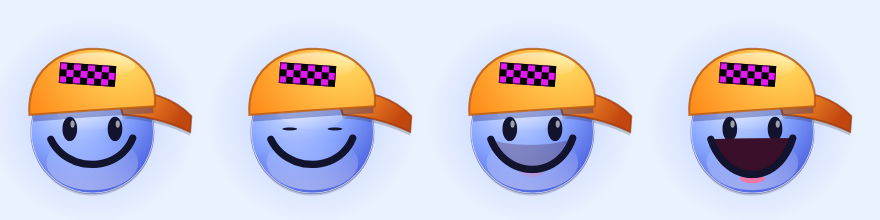

# Evil FX

**Free, open-source multi-FX for your DAW — crimson Frutiger Aero gloss meets the old-school internet.**
By [Xain Jaya](https://xainjaya.com). VST3 · CLAP · AU · LV2 · Standalone. Windows, macOS, Linux.


39 effects in a chain **you** arrange — and you only see the ones you add. Hit **+ ADD FX**, pick an effect from the categorized menu and its card drops into your **rack** (picking one that's already there jumps to it). **Drag a card's title bar to move it in the chain** (or right-click the title bar). Remove a card with its X, or bypass it with its power button. Effects that are off cost no CPU, and a safety limiter at the end keeps anything from blowing up your speakers.

---

## The chain

This is the default order. **Drag any card's title bar to move it** — put the reverb before the fuzz, the reverse delay after the blur, whatever you like. Right-click a title bar for *move to start / earlier / later / end* and *reset to the default order*. Your order saves with the project and with your own presets; factory presets start from the default order.

| # | Effect | What it does | Controls |
|---|--------|--------------|----------|
| 1 | **Noise Gate ✨** | Gate with hysteresis and hold; can be keyed from the sidechain | Key, Threshold, Range, Release |
| 2 | **Transient Shaper** | Boost or soften attacks and tails | Attack, Sustain, Mix |
| 3 | **Auto-Tune ✨** | Pitch correction to a key and scale. Speed 0 = the hard robot snap | Key, Scale, Speed, Amount, Mix |
| 4 | **Filter** | Resonant filter (LP / BP / HP) with an LFO sweep | Mode, Sync, Cutoff, Reso, LFO Rate, LFO Depth |
| 5 | **Auto-Wah** | Envelope filter: play harder, it opens further | Sens, Range, Reso, Mix |
| 6 | **Talk Box** | Vowel formant filter that morphs A-E-I-O-U, with an LFO so it talks | Voice, Sync, Vowel, Rate, Sweep, Mix |
| 7 | **EQ** | 3-band EQ: low shelf, sweepable mid, high shelf | Low, Mid, Mid Freq, High |
| 8 | **Saturation** | Warm drive with tilt EQ and auto-gain | Drive, Tone, Mix |
| 9 | **Fuzz ✨** | Real distortion: Fuzz, Hard Clip, Octave Up or Wavefolder, with a sputter gate | Type, Drive, Tone, Gate, Mix |
| 10 | **Pitch Shifter** | ±12 semitones | Pitch, Grain, Mix |
| 11 | **Ring Modulator** | Ring mod with an optional ringtone-style arpeggio | Freq, Shape, Arp, Mix |
| 12 | **Freq Shifter** | True frequency shifter (±2 kHz). A few Hz thickens, hundreds go alien | Shift, Feedback, Spread, Mix |
| 13 | **Vocoder ✨** | 16-band vocoder. Carrier: saw, chord, noise, or your sidechain | Carrier, Note, Formant, Release, Mix |
| 14 | **Robot Voice** | Metallic text-to-speech robot | Pitch, Metal, Buzz, Mix |
| 15 | **Lo-Fi Codec** | 90s audio: 22–5.5 kHz through 8-bit PCM, u-Law, A-Law or IMA ADPCM | Rate, Codec, Aliasing, Mix |
| 16 | **Bitcrusher** | Bit-depth + sample-rate reduction | Bits, Rate, Mix |
| 17 | **Telephone** | Phone line with hiss, hum, crackle and optional modem squeal | Band, Noise, Crackle, Mix, Modem |
| 18 | **Vinyl Sim** | Crackle, dust pops, worn highs and 33⅓ rpm wow | Crackle, Wear, Wow, Mix |
| 19 | **MP3 Compression** | Real spectral low-bitrate codec artifacts | Bitrate, Artifacts, Mix |
| 20 | **Packet Loss** | VoIP dropouts — robot buzz, silence or comfort noise | Loss, Packet, Concealment, Mix |
| 21 | **Stutter** | Streaming-style stutters and dropouts | Chance, Slice, Dropout, Mix |
| 22 | **Data Corruption** | Bit flips and reversed fragments | Amount, Bits, Reverse, Mix |
| 23 | **Varispeed** | Slows down, then speeds up to catch up (lag spike) | Chance, Length, Depth, Mix |
| 24 | **Wow & Flutter** | Tape wow, flutter and clock drift | Wow, Flutter, Drift, Mix |
| 25 | **Beat Repeat 🎵** | Repeat / stutter / reverse / tape stop on the grid | Division, Style, Chance, Mix |
| 26 | **Trance Gate 🎵** | Rhythmic gate with 8 patterns | Pattern, Division, Depth, Smooth |
| 27 | **Sidechain Pump 🎵** | Ducking on the beat grid — or follows your DAW's sidechain input ✨ | Source, Rate, Depth, Release |
| 28 | **Volume Swell** | Fades in every new note or chord | Attack, Sens, Mix |
| 29 | **Chorus** | Lush stereo chorus | Sync, Rate, Depth, Feedback, Mix |
| 30 | **Flanger** | Jet-whoosh flanger with stereo sweep | Sync, Rate, Depth, Feedback, Mix |
| 31 | **Phaser** | Multi-stage phaser | Sync, Rate, Depth, Feedback, Mix |
| 32 | **Tremolo / Pan** | Tremolo that morphs into auto-pan | Sync, Rate, Depth, Shape, Pan |
| 33 | **Stereo Widener** | Mono-safe widener with slow motion | Width, Motion, Mix |
| 34 | **Reverse Delay 🎵** | Plays each chunk back backwards — instant reverse swells | Sync, Time, Feedback, Mix |
| 35 | **Delay 🎵** | Stereo / ping-pong delay with tone and tempo sync | Sync, Time, Feedback, Tone, Mix |
| 36 | **Blur** | Smears everything into a huge ambient wash. Shimmer adds octave-up sparkle, Freeze holds the sound forever | Size, Smear, Shimmer, Mix, Freeze |
| 37 | **Reverb** | Big hall reverb | Size, Damp, Width, Mix |
| 38 | **Compressor** | Easy compressor with auto makeup | Amount, Ratio, Speed, Mix |
| 39 | **Speaker Sim** | PC speaker, laptop, flip phone, earbuds, CRT TV, boombox | Model, Drive, Mix |
| — | **Master** | Input / output gain, stereo width, global mix, safety limiter + meter | |

✨ = new in v1.2. 🎵 = locks to your project tempo. With the transport stopped it keeps running on its own clock at the project BPM, so you can still hear it. **Sync** dropdowns lock that effect's LFO to the tempo too (4 bars down to 1/16, including triplets) — the sweep lands in the same place every bar.

**Sidechain:** Evil FX has an optional sidechain input. Route a kick (or anything) to it in your DAW and set Sidechain Pump's *Source* to *Sidechain In*, Noise Gate's *Key* to *Sidechain In*, or the Vocoder's *Carrier* to *Sidechain In*. The status bar shows **SC** when a sidechain is connected; with nothing connected those effects fall back to their normal behaviour.

## What's new in v1.2

- **Arrange your own chain** — drag cards to reorder the effects; right-click a title bar for more.
- **Undo / Redo** (Ctrl/Cmd+Z, Ctrl/Cmd+Shift+Z) for knob moves, presets, RANDOM, adding/removing/reordering effects.
- **A / B compare** — two complete sounds you flip between; **A > B** copies what you hear into the other slot. Both save with the project.
- **Tempo-synced LFOs** on Filter, Talk Box, Chorus, Flanger, Phaser and Tremolo.
- **4 new effects** — Auto-Tune, Vocoder, Fuzz, Noise Gate — and a **sidechain input** for Pump, Gate and Vocoder.
- **BROWSE** (Ctrl/Cmd+F) — search every preset, filter by category, ★ favourites (they also appear at the top of the preset menu).

  
- **102 factory presets**, including new *Vocals & Robots*, *Fuzz & Drive* and *Tempo Motion* categories.
- **The mascot is alive** — it blinks, and grins wider the louder your mix gets.

  
- **Fix:** delay-based effects (since v1.0) could occasionally read one sample past their buffer, causing rare random glitches or dropouts. Found with valgrind, fixed everywhere, and the test suite now runs every effect under it clean.
- **CLAP** format, plus proper **installers** (Windows .exe, macOS .pkg, Linux tarball with install script) and signing/notarization in CI.

## What's new in v1.1

- **New logo** — a glossy blue smiley in a sideways orange cap with a purple-and-black checker patch. It's also the Standalone app icon.
- **4 new effects** — Talk Box, Freq Shifter, Flanger and Reverse Delay (tempo-synced).
- **18 new presets** spread across every category, e.g. *Smiley Says Hi*, *Talking Clouds*, *Reverse Halo*, *Jet Flanger Drums*, *Alien Transmission* and *Smiley Meltdown*.
- Projects saved with v1.0 open with the same rack — the new effects just start switched off.

## Features

- **+ ADD FX menu** — effects grouped into Tone & Dynamics, Pitch & Voice, Lo-Fi & Internet Damage, Rhythm (BPM synced), Modulation & Stereo, and Ambient & Space. Ticks show what's already in your rack.
- **Full-width rack** — 5 cards across, scrolls when you add more, with a "more FX below" button and a glow on the card you just added or jumped to.
- **102 factory presets** in categories: Start, Studio Tools, Heavenly, Ambient Pads, Internet Era, Rhythm & Glitch, Lo-Fi & Speakers, Chaos, Vocals & Robots, Fuzz & Drive, Tempo Motion.
- **Save your own presets** — hit **SAVE**. They're stored in `Documents/Evil FX/Presets` and appear under *Your Presets*. Share the `.evilfx` files with friends.
- **RANDOM** — switches on a few random effects with random settings.
- **Themes** — Aero Sky (default), Frutiger Metro and Crimson Grid, saved with your project.


- **VISUALIZER.EXE** — WinAmp-style spectrum bars or scope. Off by default; zero cost while off.
- **Lightweight** — the background is drawn once per theme, the UI only redraws what changes, and the audio thread never allocates.
- **Safe** — click-free switching, latency reported to your DAW, NaN guard, and a safety limiter.
- **? button** — quick help inside the plugin. The **xainjaya.com** button at the top right opens the website.
- **Huge ambient pads** — try the Ambient Pads presets, or Blur + Volume Swell + Reverb. Hit Freeze on Blur to hold a chord forever.

## CPU cost

Measured with `EvilFXTests --bench` (Release, 48 kHz stereo, one desktop core). Effects that are off are skipped entirely.

| Effect | CPU | Effect | CPU | Effect | CPU |
|---|---|---|---|---|---|
| Filter | 0.06 % | Telephone | 0.23 % | Sidechain Pump | 0.08 % |
| EQ | 0.07 % | Vinyl Sim | 0.14 % | Chorus | 0.12 % |
| Saturation | 0.21 % | MP3 Compression | 1.73 % | Phaser | 0.40 % |
| Pitch Shifter | 0.14 % | Packet Loss | 0.03 % | Tremolo / Pan | 0.14 % |
| Ring Modulator | 0.22 % | Stutter | 0.05 % | Stereo Widener | 0.08 % |
| Robot Voice | 0.27 % | Data Corruption | 0.06 % | Delay | 0.19 % |
| Lo-Fi Codec | 0.13 % | Varispeed | 0.03 % | Reverb | 0.25 % |
| Bitcrusher | 0.02 % | Wow & Flutter | 0.09 % | Compressor | 0.13 % |
| Beat Repeat | 0.03 % | Trance Gate | 0.03 % | Speaker Sim | 0.33 % |
| Blur | 0.60 % | Transient Shaper | 0.17 % | Volume Swell | 0.12 % |
| Auto-Wah | 0.07 % | Talk Box | 0.27 % | Freq Shifter | 0.26 % |
| Flanger | 0.32 % | Reverse Delay | 0.30 % | Noise Gate | 0.03 % |
| Fuzz | 0.36 % | Auto-Tune | 0.62 % | Vocoder | 0.72 % |
| | | | | **All 39 on** | **~9 %** |

## Building

You need **CMake 3.22+** and a C++17 compiler (Visual Studio 2022, Xcode 14+, or GCC 11+/Clang 14+). JUCE 8 and [clap-juce-extensions](https://github.com/free-audio/clap-juce-extensions) are downloaded automatically (turn CLAP off with `-DEVIL_BUILD_CLAP=OFF`).

```bash
cmake -B build -DCMAKE_BUILD_TYPE=Release
cmake --build build --config Release --parallel
```

Plugins land in `build/EvilFX_artefacts/Release/` (`VST3/`, `CLAP/`, `AU/`, `LV2/`, `Standalone/`).

**Linux packages:** `build-essential cmake ninja-build libasound2-dev libjack-jackd2-dev libfreetype6-dev libfontconfig1-dev libx11-dev libxcomposite-dev libxcursor-dev libxext-dev libxinerama-dev libxrandr-dev libxrender-dev libglu1-mesa-dev` (or add `-DEVIL_MINIMAL_LINUX_DEPS=ON` in a stripped-down container).

**macOS:** add `-DCMAKE_OSX_ARCHITECTURES="arm64;x86_64"` for a universal build.

### Installers

| Platform | Installer | Built by |
|----------|-----------|----------|
| Windows | `EvilFX-<version>-Windows-Setup.exe` — pick VST3 / CLAP / standalone | `packaging/windows/EvilFX.iss` (Inno Setup 6) |
| macOS | `EvilFX-<version>-macOS.pkg` — pick VST3 / AU / CLAP / standalone | `packaging/macos/make_pkg.sh` |
| Linux | `EvilFX-<version>-Linux.tar.gz` with `install.sh` (installs to `~/.vst3`, `~/.clap`, `~/.lv2`) | CI |

GitHub Actions (`.github/workflows/build.yml`) builds all three platforms on every push, runs the tests, and builds the installers. **Push a tag like `v1.2.0` and it publishes a GitHub Release** with every installer attached.

### Code signing

Unsigned builds work, but Windows SmartScreen and macOS Gatekeeper will warn people. Signing switches on automatically once these repository secrets exist (*Settings → Secrets and variables → Actions*):

| Secret | What it is |
|--------|-----------|
| `WINDOWS_CERT_PFX_BASE64`, `WINDOWS_CERT_PASSWORD` | Your Windows code-signing certificate (.pfx, base64-encoded) and its password |
| `MACOS_CERT_P12_BASE64`, `MACOS_CERT_PASSWORD` | A .p12 holding your *Developer ID Application* **and** *Developer ID Installer* certificates (base64) |
| `MACOS_DEV_ID_APP`, `MACOS_DEV_ID_INSTALLER` | Their names, e.g. `Developer ID Application: Xain Jaya (ABCDE12345)` |
| `APPLE_ID`, `APPLE_TEAM_ID`, `APPLE_APP_PASSWORD` | For notarization (an [app-specific password](https://support.apple.com/102654)) |

Base64 a certificate with `base64 -i cert.p12 | pbcopy` (macOS) or `[Convert]::ToBase64String([IO.File]::ReadAllBytes("cert.pfx"))` (PowerShell). The macOS certificates come from an Apple Developer account; Windows certificates from a CA such as Certum, Sectigo or SSL.com (or Azure Trusted Signing).

### Installing by hand

| Format | Windows | macOS | Linux |
|--------|---------|-------|-------|
| VST3 | `C:\Program Files\Common Files\VST3\` (copy the whole `Evil FX.vst3` folder) | `~/Library/Audio/Plug-Ins/VST3/` | `~/.vst3/` |
| CLAP | `C:\Program Files\Common Files\CLAP\` | `~/Library/Audio/Plug-Ins/CLAP/` | `~/.clap/` |
| AU | — | `~/Library/Audio/Plug-Ins/Components/` | — |
| LV2 | — | — | `~/.lv2/` |

Unsigned macOS builds may need `xattr -cr "Evil FX.vst3"`.

**FL Studio:** Options → Manage plugins → make sure the VST3 folder is listed → tick *Verify plugins* → *Find installed plugins* → star **Evil FX**.

---

## Project layout

```
Source/
  Params.h              every parameter (IDs, ranges, units)
  Rack.h                default chain order, saved order, which effects are in the rack
  Presets.h             factory presets, user presets, randomize
  PluginProcessor.*     the chain, transport/BPM, master, limiter, latency
  PluginEditor.*        window, + ADD FX menu, rack, themes, presets UI
  dsp/Modules.h         core effects + Slot wrapper (power switch / fades)
  dsp/NetModules.h      internet-era pack (codec, packet loss, corrupt, lag, jitter, speaker)
  dsp/BeatModules.h     glitch, gate, nightcore, ringtone, glory comp
  dsp/ExtraModules.h    EQ, vinyl, robot voice, sidechain pump, stereo widener
  dsp/AmbientModules.h  transient shaper, auto-wah, volume swell, blur
  dsp/FreshModules.h    talk box, frequency shifter, flanger, reverse delay
  dsp/ProModules.h      noise gate, fuzz, auto-tune, vocoder
  ui/EvilLookAndFeel.h  glossy crimson orbs, Win9x bevels, the smiley mascot logo
  ui/ModuleCard.h       one card per effect
  ui/Visualizer.h       VISUALIZER.EXE
  ui/PresetBrowser.h    BROWSE: search, categories, favourites
packaging/              Windows (Inno Setup), macOS (.pkg) and Linux installers
Tests/HeadlessTests.cpp stress test, fuzzing, presets, CPU bench, UI snapshot, icon render
docs/icon.png           the mascot (app icon) — regenerate with `EvilFXTests --icon docs/icon.png 512`
```

### Adding an effect

1. Add its parameters (including `yourfx_on`) in `Params.h`.
2. Write a class deriving from `xfx::Module` (`prepare`, `reset`, `process(L, R, n)`). Take a `const Transport&` for tempo sync, a `const SideChain&` for the sidechain input.
3. Add it in the `EvilFXProcessor` constructor, `ModuleIndex`, and `Rack.h` (same position, bump `numModules`). Saved projects store effects by ID, so old projects keep working.
4. Add a `CardSpec` in `moduleSpecs()` in `PluginEditor.cpp` (same position) and give it a menu category in `categoryOf()`.

## License

**AGPL-3.0-or-later** — see [LICENSE](LICENSE). Built on [JUCE](https://juce.com) under its AGPLv3 option.

VST is a trademark of Steinberg Media Technologies GmbH. Audio Unit is a trademark of Apple Inc.
